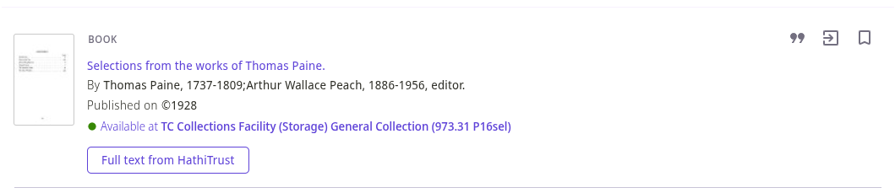

# HathiTrust Availability NDE Add-on

## Details

- Name: `orca-hathi-trust`
- URL: `https://alliance-pcsg.github.io/nde-add-ons/orca-hathi-trust/`
- Configuration JSON Template: [orca-hathi-trust.json](./orca-hathi-trust.json)
- Placement: `nde-online-availability-before`
- Component Folder: [`src/app/orca-hathi-trust`](../../app/orca-hathi-trust)
- Component Selector: `orca-hathi-trust`

## Description

Adapted from the [University of Minnesota Libraries' HathiTrust NDE add-on](https://github.com/UMNLibraries/primo-nde), which is the NDE version of their [legacy Primo HathiTrust availability plugin](https://github.com/UMNLibraries/primo-explore-hathitrust-availability).

When a local (non-CDI) search result is displayed in Primo, the record's OCLC numbers (or other optional identifiers) are passed to the [HathiTrust Bib API](https://www.hathitrust.org/bib_api). If at least one item with free full-text access is found, a link to the HathiTrust record is appended to the availability section.

## Configuration

Primo requires a configuration file for every add-on. If the defaults suit you, upload a file containing an empty JSON object: `{}`.

| Option                       | Type    | Default | Description                                                                                                                                                                                                                                 |
| ---------------------------- | ------- | ------- | ------------------------------------------------------------------------------------------------------------------------------------------------------------------------------------------------------------------------------------------- |
| `disableWhenAvailableOnline` | boolean | true    | Don't check for HathiTrust availability if the record already has online access.                                                                                                                                                            |
| `disableForJournals`         | boolean | false   | Don't check for HathiTrust availability if the record type is a journal.                                                                                                                                                                    |
| `ignoreCopyright`            | boolean | false   | Display availability links on all records in HathiTrust, including works not in the public domain. Normally, you won't want to enable this unless [ETAS](https://www.hathitrust.org/member-libraries/services-programs/etas/) is in effect. |
| `matchOn.oclc`               | boolean | true    | Search HathiTrust using the record's OCLC number(s). This is usually the most reliable match point for HathiTrust records.                                                                                                                  |
| `matchOn.isbn`               | boolean | false   | Search HathiTrust using the record's ISBN(s).                                                                                                                                                                                               |
| `matchOn.issn`               | boolean | false   | Search HathiTrust using the record's ISSN(s).                                                                                                                                                                                               |
| `matchOn.lccn`               | boolean | false   | Search HathiTrust using the record's LCCN(s).                                                                                                                                                                                               |

You can enable any combination of `matchOn` identifiers, as long as at least one is enabled.

See [orca-hathi-trust.json](./orca-hathi-trust.json) for an example configuration with every option set to its default.

## Customizing the availability text

The default link text is "Full text from HathiTrust".

To change it, add a row to the Primo VE **NDE Custom Defined Labels** code table with the code `HathiTrust.availabilityText` and a description of your choosing.
